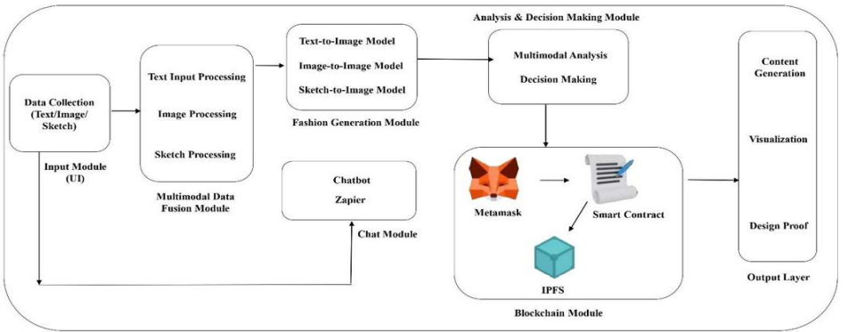
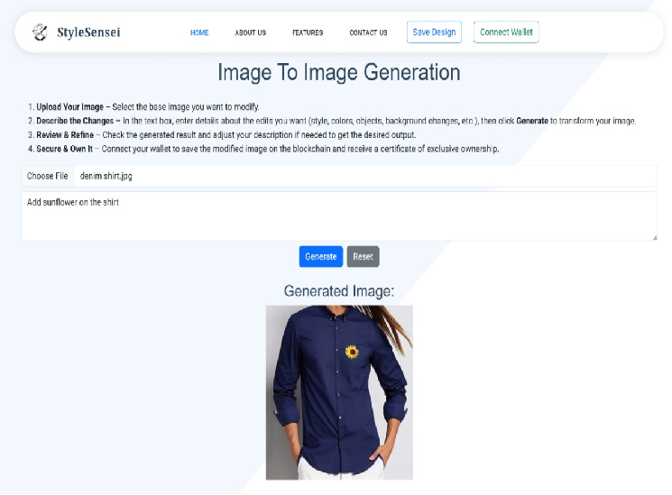
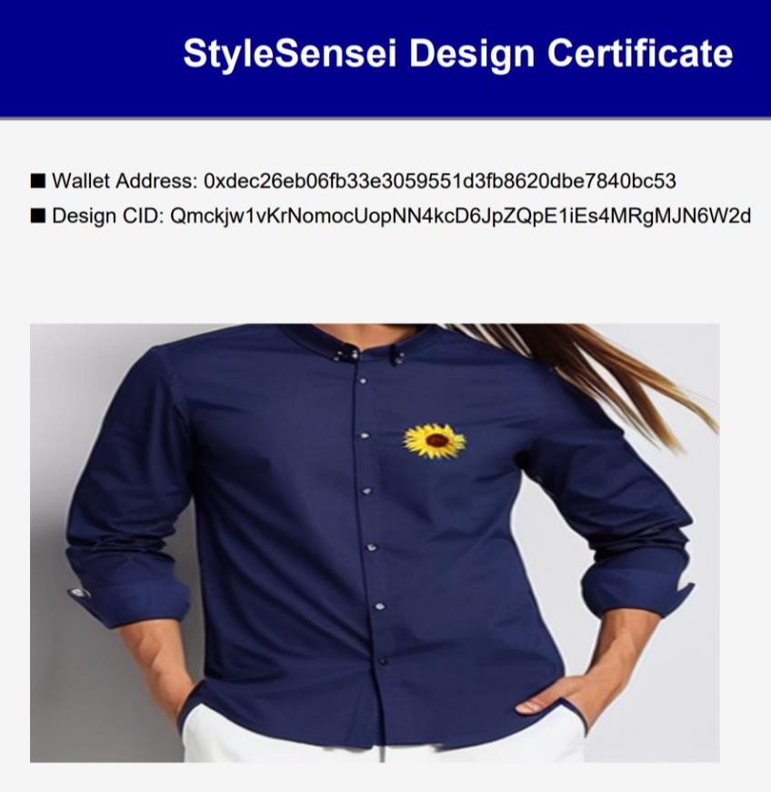

<h1 align="center">👗 StyleSensei - Multimodal AI Fashion Assistant</h1>

  <b>Generate. Transform. Own.</b> 

## 📌 Overview

StyleSensei is a **multimodal generative AI system** that enables users to create and transform fashion designs using **text, images, and sketches**.

### 🔗 Core Technologies

* 🎨 **Stable Diffusion** for image generation
* ⚙️ **Flask backend** for orchestration
* 🔐 **Ethereum smart contracts** for ownership verification
* 📦 **IPFS** for decentralized storage

It combines **creative generation with verifiable ownership** in a unified pipeline.

---

## 🚀 Key Features

* ✨ Text-to-image fashion generation
* 🖼️ Image-to-image transformation
* ✏️ Sketch-to-design conversion
* 🤖 AI-based styling assistant
* 🔐 Blockchain-based ownership registration
* 📦 Decentralized storage using IPFS
* 🎯 Personalized recommendations

---

## 🏗️ System Architecture

  

---

## 📈 Performance Metrics

* ⏱️ **Text-to-Image:** ~10–20 sec (GPU)
* ⚡ **Image-to-Image:** ~8–15 sec
* ✏️ **Sketch-to-Image:** ~12–22 sec
* 🖥️ **GPU Usage:** ~70–95%
* 🚀 **Latency Improvement:** ~5–10x faster than CPU

---

## 🖼️ UI Preview

### 🧾 Text-to-Image Generation

  

### 🖼️ Image-to-Image Transformation

  

### ✏️ Sketch-to-Image Generation

  

### 🏷️ Design Certificate (Ownership)

  

---

## 🛠️ Tech Stack

### 🤖 AI / ML

* Stable Diffusion
* Multimodal Generation

### ⚙️ Backend

* Python, Flask

### 🎨 Frontend

* HTML, CSS, JavaScript, Bootstrap

### 🔐 Blockchain

* Ethereum, Smart Contracts, MetaMask

### 📦 Storage

* IPFS

---

## ⚙️ Installation

### 📌 Prerequisites

* Python 3.8+
* Node.js (for Truffle)
* Ganache
* Truffle
* MetaMask

---

## 🔐 Blockchain Design

* 🔑 Each design is hashed
* 📜 Hash stored via **Ethereum smart contract**
* 📦 Assets stored on **IPFS**
* ✅ Ownership verifiable via blockchain

---

## 🧠 Challenges & Learnings

* Handling **multimodal inputs** in a unified pipeline
* Reducing **Stable Diffusion latency**
* Integrating **AI + blockchain workflows**
* Managing **IPFS-based storage**

---

## 🎯 Use Cases

* 👗 Fashion Designers
* 🎨 Digital Creators
* 🛒 E-commerce Platforms
* 🤖 AI Styling Tools
* 🧪 Design Prototyping

---

## 📄 Research Publication

📘 **International Journal of Innovative Research in Technology (IJIRT)**
*Revolutionizing Fashion Design with Multimodal Generative AI and Blockchain-Enabled Ownership*

🔗 https://ijirt.org/article?manuscript=192431

---

## 💡 Project Motivation

Traditional fashion workflows lack:

* ⚡ Rapid prototyping
* 🎯 Personalization
* 🔐 Ownership protection

StyleSensei addresses these using:

* 🤖 AI for generation
* 🔗 Blockchain for trust

---

## 🔮 Future Enhancements

* ⚡ Real-time generation optimization
* 👕 Virtual try-on integration
* 📱 Mobile-friendly interface
* 🤝 Collaborative design features

